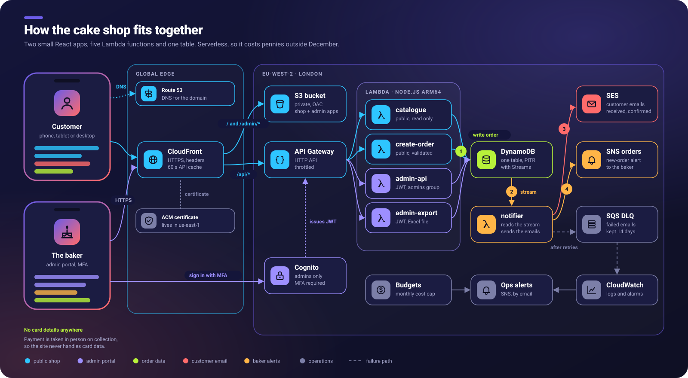
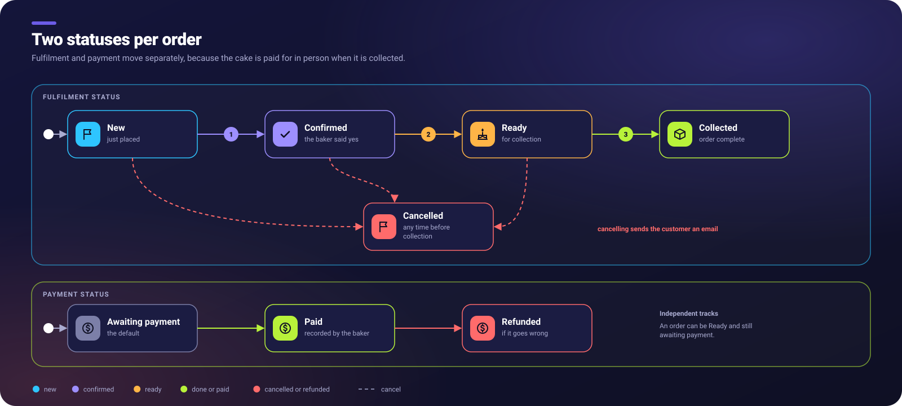
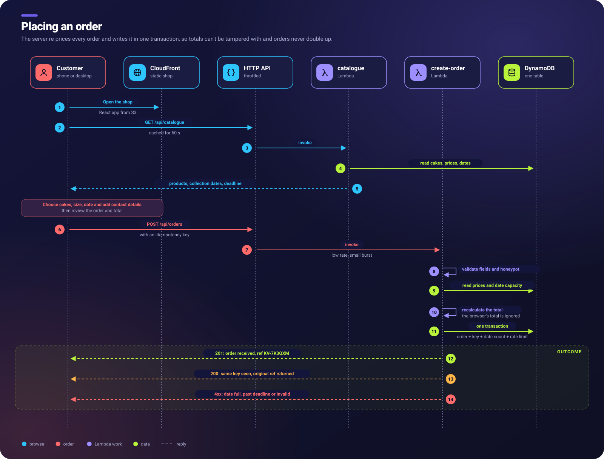
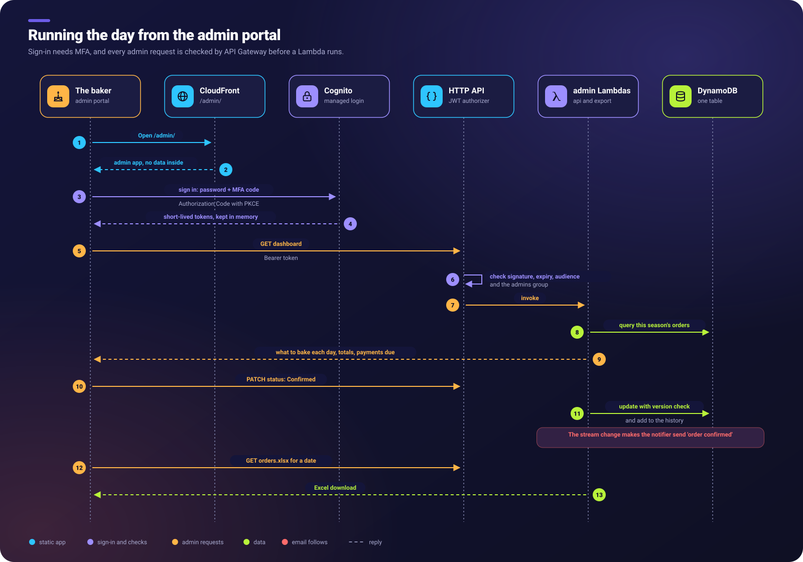
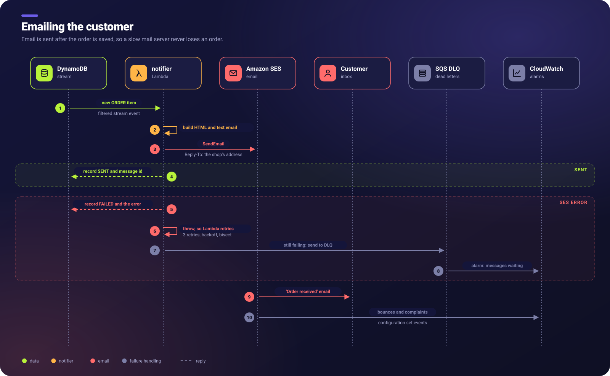
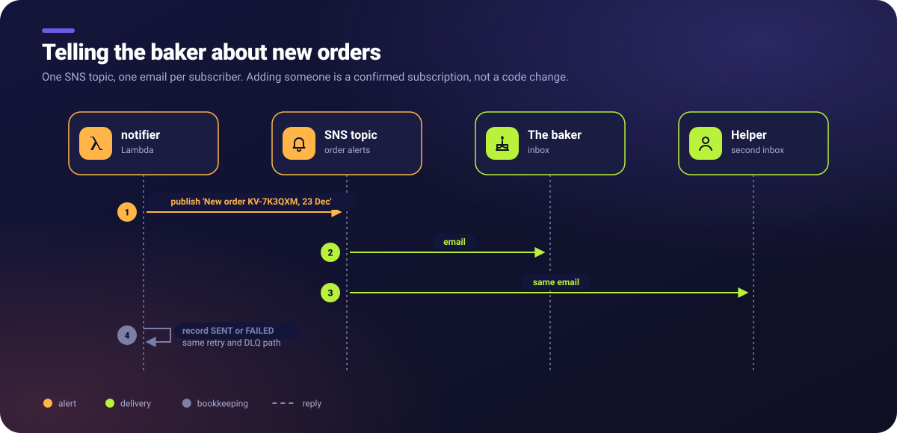

# Architecture

> Phase 1 proposal. Nothing described here has been built or deployed.

## 1. Architecture diagram

The main ideas in the diagram:

- **One domain, one CloudFront distribution.** The customer shop (`/`), the admin portal
  (`/admin/`) and the API (`/api/*`) all share one origin as far as the browser is concerned.
  That removes CORS configuration, needs only one TLS certificate, and keeps the API endpoint
  out of the page source.
- **Two kinds of API route.** Public routes (catalogue, place order) need no login and are
  heavily throttled. Admin routes require a valid Cognito access token for a user in the
  `admins` group. API Gateway checks that token before any Lambda runs.
- **Write first, notify second.** `public-create-order` only writes to DynamoDB and returns
  the reference. Emails are sent afterwards by `notifier`, which DynamoDB Streams triggers.
  So an email outage can never lose an order or show the customer an error.
- **No servers and no fixed hourly cost.** The only fixed monthly charge is the Route 53
  hosted zone (US$0.50).

## 2. Service choices

See [aws-services.md](aws-services.md) for each service, what it does here, why it was
chosen and what was rejected.

## 3. API surface (proposed)

| Method and path | Auth | Lambda | Purpose |
|---|---|---|---|
| `GET /api/catalogue` | none | public-catalogue | Enabled products, variants, prices, open collection dates, ordering deadline. CloudFront caches it for 60 seconds. |
| `POST /api/orders` | none | public-create-order | Validate and store an order, then return the reference |
| `GET /api/admin/dashboard` | admin | admin-api | Counts and totals for the dashboard tiles |
| `GET /api/admin/orders` | admin | admin-api | List with filters: `status`, `payment`, `collectionDate`, `q` (name or reference), `notifyFailed` |
| `GET /api/admin/orders/{ref}` | admin | admin-api | Order detail and history |
| `PATCH /api/admin/orders/{ref}` | admin | admin-api | Change fulfilment or payment status, or add an internal note. Uses an optimistic `version` check. |
| `POST /api/admin/orders/{ref}/resend` | admin | admin-api | Re-queue a failed notification |
| `POST /api/admin/orders/{ref}/erase` | admin | admin-api | UK GDPR erasure (anonymise personal fields) |
| `GET/PUT /api/admin/products[/{id}]` | admin | admin-api | Prices, descriptions, enable or disable |
| `GET/PUT /api/admin/settings` | admin | admin-api | Season, ordering deadline, collection dates, capacity |
| `GET /api/admin/exports/orders.xlsx` | admin | admin-export | Excel download, using the same filters as the order list |

## 4. Order lifecycle

Fulfilment and payment are **two independent fields**, as the brief requires.

The rules are enforced in `admin-api`, not only in the UI:

- Only the transitions shown are allowed. Moving backwards (for example, Collected to New)
  is rejected with a clear message.
- Marking an order **Collected** while it is still **Awaiting payment** is allowed, because
  the baker may agree to be paid later. The dashboard keeps showing it under "Outstanding payments".
- **Refunded** is only possible from **Paid**.
- **Completed** on the dashboard means *Collected and Paid*.
- Every change appends a history entry recording who, when, from and to. That gives the baker an
  audit trail.

## 5. Customer ordering workflow

Key points:

- **The server is the authority on price.** The browser shows a running total for
  convenience, but `public-create-order` reloads the prices and recalculates everything. Each
  order line stores a snapshot of the **unit price at the time of ordering**, held as integer
  pence to avoid floating-point rounding.
- **Duplicate protection works at two levels.** The browser disables the button and creates
  an `idempotencyKey` (a UUID) once per checkout. A double-click, a retry on a slow network,
  or a refresh with a resubmit all reuse that key. DynamoDB's conditional write guarantees
  that only one order is created, and later calls get the same reference back. Idempotency
  records expire automatically after 24 hours using DynamoDB TTL.
- **The order reference** looks like `KV-7K3QXM`: a prefix plus six random Crockford base32
  characters, which leave out I, L, O and U so the reference is easy to read out over the
  phone. That gives about one billion combinations. A conditional write rejects the rare
  clash, and the code simply generates another. References are random rather than
  sequential, so nobody can guess how many orders exist or step through them.
- **The ordering deadline and collection dates** come from settings that the baker controls. They
  are checked on the server, not just hidden in the UI.
- **Validation** uses one shared schema (Zod) for both the browser and the Lambda. It
  covers name length, email format, UK phone format, quantity limits, a maximum number of
  lines and the length of the notes. The notes are stored as plain text and escaped wherever
  they are displayed.

## 6. Administrator workflow

Design notes for the baker's usability:

- **Big, plain buttons for the common actions:** Confirm, Mark paid, Ready, Collected and
  Cancel. Each status change shows a confirmation that names the order, for example
  "Mark KV-7K3QXM as paid?".
- The **default view is "upcoming collections"**, grouped by date. That is most likely what
  she needs on a busy day.
- She can **edit prices, products and dates** in simple forms. Prices are typed in pounds and
  stored in pence.
- **Sessions expire** after a set time of inactivity. Signing in again uses Cognito's hosted
  page, so the app never handles her password.

## 7. Customer email workflow (SES)

> **Deferred (D3):** the email approach will be revisited once there is a domain. The
> customer email starts switched off. See [decisions.md](decisions.md).

The **content** of the acknowledgement covers everything the brief lists. The wording makes
the received/accepted distinction explicit:

> **Thank you, Jane, we've received your order KV-7K3QXM.**
> This email confirms that we have *received* your request. It is **not yet confirmed**.
> We'll review it and email you again once your order is accepted.
> **Payment is made in person when you collect.** We do not take payment online and will
> never ask for card details by email.

Other details:

- The email is sent in both **HTML and plain text**. It uses the deep red, white and gold
  branding, with inline CSS so it renders well in Gmail, Outlook and Apple Mail.
- The templates live **in the repository**, next to the notifier code, rather than as SES
  stored templates. That way they are versioned, reviewable and unit-testable.
- The sending domain gets **SPF, DKIM and DMARC**, all created by CloudFormation in Route 53,
  so the emails do not land in spam.
- **Reply-To** is the public business contact address (Q4). It is never the baker's or her son's
  private address.
- **SES starts in sandbox mode** in every new account. In the sandbox it can only send to
  verified addresses, which is fine for testing. Moving to production access is a one-time
  request to AWS that cannot be done in CloudFormation. It will be documented as a required
  manual step in Phase 4.

## 8. Internal notification workflow (SNS)

- **The topic** is `<BusinessName>OrderNotifications` in prod. Other environments get a suffix,
  for example `<BusinessName>OrderNotifications-dev`, so they never clash. It is encrypted with
  the AWS-managed `alias/aws/sns` key, which costs nothing.
- **Subscribers** come from a CloudFormation parameter (`InternalNotificationEmails`, a
  comma-separated list). Adding a third person means changing that parameter and running a
  stack update. The real addresses live in a **parameter file that git ignores**. Only an
  `.example` file with placeholders is committed.
- **The message** is plain text. It contains the customer's name, email and phone, the
  reference, the lines and quantities, the total and the collection date. Customers never see
  the topic, its ARN or the subscriber addresses, because the topic is only reachable through
  the notifier's IAM role.

**The subscription confirmation process** (it will be documented step by step in Phase 4):

1. Deploying the stack creates each email subscription in *PendingConfirmation*.
2. AWS emails each address: "AWS Notification – Subscription Confirmation".
3. Each recipient clicks **Confirm subscription** within 3 days, or the link expires.
4. The deployer checks the result with
   `aws sns list-subscriptions-by-topic --topic-arn …`. Every row should show a real
   SubscriptionArn rather than `PendingConfirmation`.
5. If a link expired or was missed, re-running the stack update with the same parameters
   does **not** resend it. The fix is documented: remove the address, update, add it back,
   update again, or resend from the CLI.

There are two known SNS limitations, and the mitigations I propose:

- Every SNS email has an **unsubscribe link in the footer**. One accidental click silently
  stops that person's notifications. To mitigate this, the admin dashboard will show
  **"Internal notifications: 2 of 2 recipients subscribed"**, using a read-only
  `sns:ListSubscriptionsByTopic` call. A CloudWatch alarm will also fire if the count drops.
- SNS email is **plain text**, and the sender is "AWS Notifications". That is fine for an
  internal alert. The customer email, which needs to look professional, uses SES.

## 9. Notification reliability summary

| Requirement | How it is met |
|---|---|
| An order is never lost because email fails | The order is written in its own transaction before any email code runs. The two happen in separate Lambdas. |
| The customer sees success even if email fails | `public-create-order` returns 201 as soon as the write succeeds. It never waits for email. |
| Failures are logged | Structured JSON logs with the order reference and error code only, never personal details |
| Failed orders can be identified | Each order stores `customerEmail.status` and `internalNotify.status`. The admin list has a "Notification problems" filter, and the dashboard shows a warning banner. |
| Retries | The DynamoDB Stream event source mapping retries up to 3 times, with bisect-on-error so one bad record cannot block others. A record older than 24 hours is not retried automatically. |
| Dead-letter queue | An SQS DLQ receives the failed stream record metadata. A CloudWatch alarm on `ApproximateNumberOfMessagesVisible > 0` emails the ops alert topic. |
| Manual recovery | A "Resend notifications" button (`POST /orders/{ref}/resend`) in the admin portal |
| No double sends on retry | The notifier checks the status fields first and skips any channel already marked `SENT`. |

**Why a stream and a DLQ, rather than sending email inside the create-order Lambda?**
Sending inline would be simpler, but it would make the customer wait on SES and SNS. A
failure in the middle would also leave it unclear whether the customer should see an error.
A stream separates the two concerns completely. It costs nothing extra, because Lambda's
reads from DynamoDB Streams are free, and SQS is pennies. It is also a good, realistic
pattern to learn for the portfolio.

## 10. Environments

| | dev | prod |
|---|---|---|
| Domain | CloudFront default `*.cloudfront.net` (no certificate needed) | CloudFront default for now (D2). Later, a custom domain + ACM. |
| SES | Sandbox (verified test addresses only) | Customer email switched off until there is a domain (D3). Later, production access. |
| SNS subscribers | The operator only | The baker + the operator |
| Data | Synthetic test data | Real customers |
| Deletion protection | Off | On (table, Cognito pool) |

Both environments can live in one AWS account, with names namespaced by an `Environment`
parameter. Separate accounts would isolate them better at no extra cost, but they would add
setup work. See Q17.
