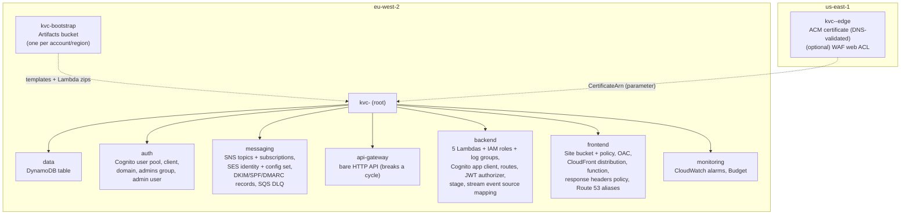

# CloudFormation stack structure

> Phase 1 proposal. No templates have been written yet. They are Phase 2 work.

## 1. Design principles

- **CloudFormation only.** No Terraform, no CDK, and no SAM transform. Plain YAML templates
  keep every resource visible.
- **A small number of stacks, split by lifecycle and region,** not one stack per resource.
  Resources that change together, or depend on each other's names, live together.
- **Nested stacks** under one root stack in eu-west-2. One `deploy` or `delete` command
  manages the whole application. Each nested template stays small enough to read in one
  sitting.
- **Parameters, not edits.** Environment differences (dev and prod, domain, email addresses)
  are parameters. Templates stay identical across environments.
- **Stateful resources are protected.** The DynamoDB table and the Cognito user pool use
  `DeletionPolicy: Retain` and `UpdateReplacePolicy: Retain`, plus service-level deletion
  protection in prod. An accidental stack delete or a replacing update cannot destroy
  customer data.

## 2. Stack layout

> **Decision D2:** there is no domain yet, so the `edge` stack is not deployed and the root
> stack runs with `DomainName` empty. The Cognito app client is created after the
> CloudFront distribution, because its callback URL depends on the distribution's domain. See
> [decisions.md](decisions.md).

| Stack | Region | Lifecycle | Contents |
|---|---|---|---|
| `kvc-bootstrap` | eu-west-2 | Once per account | Encrypted, versioned, private S3 bucket for `aws cloudformation package` output: nested templates and Lambda zips. Lifecycle rule expires old versions. |
| `kvc-<env>-edge` | us-east-1 | Rarely changes | ACM certificate for `domain` and `www.domain`, validated through the Route 53 zone. It also holds the optional CloudFront-scope WAF web ACL, which must also be in us-east-1. It is skipped entirely in dev if dev uses the default CloudFront domain. |
| `kvc-<env>` | eu-west-2 | Every release | The root stack, with seven nested stacks (below) |

### Nested stacks under the root

| Nested stack | Key outputs | Depends on |
|---|---|---|
| `data` | `TableName`, `TableArn`, `TableStreamArn` | none |
| `auth` | `UserPoolId`, `UserPoolArn`, `AppClientId`, `CognitoDomain`, `IssuerUrl` | none. Callback URLs are built from the `DomainName` parameter, so there is no circular dependency on CloudFront. |
| `messaging` | `OrderTopicArn`, `OpsTopicArn`, `SesIdentityArn`, `ConfigSetName`, `NotifierDlqArn` | `HostedZoneId` parameter (for the DKIM records) |
| `api-gateway` | `HttpApiId`, `HttpApiDomain` | none |
| `frontend` | `DistributionId`, `SiteUrl`, `SiteBucketName` | `api-gateway` (origin domain), `auth` (Cognito domain for the CSP), edge outputs (parameters) |
| `backend` | `AdminAppClientId`, function names | `data`, `auth`, `messaging`, `api-gateway`, `frontend` (SiteUrl for the Cognito callback) |
| `monitoring` | none | `backend` (function names), `messaging` (DLQ, topics), `api-gateway` |

> **Changed in Phase 2:** the single `api` stack from the Phase 1 proposal became
> `api-gateway` plus `backend`, and the Cognito app client moved from `auth` to `backend`.
> Without a custom domain there is a dependency cycle: CloudFront needs the API, the app
> client needs CloudFront's URL, and the JWT authorizer needs the app client. Creating the
> bare API first breaks that cycle. See `infrastructure/cloudformation/README.md`.

CloudFormation works out the order from the `!GetAtt Nested.Outputs.X` references in the
root template: data, auth, messaging and api-gateway in parallel, then frontend, then backend, then monitoring.

### Why the cross-region parameter is passed by the script

CloudFormation **exports and `ImportValue` do not work across regions**. The edge stack's
`CertificateArn` output is therefore read by the deploy script
(`aws cloudformation describe-stacks --region us-east-1 …`) and passed into the root stack as
a parameter. This is the one "glue" step. It is in the script, not done by hand.

### Why not more, smaller top-level stacks?

Separate top-level stacks linked by exports make the stacks hard to change. You cannot
modify an export while another stack imports it. Nested stacks under one root keep
independent templates without that locking. They also roll back as one unit if any part
fails.

## 3. Parameters

| Parameter | Example | Notes |
|---|---|---|
| `Environment` | `dev` / `prod` | Drives names, retention and protections through `Conditions` |
| `ProjectName` | `kvc` | Prefix for resource names |
| `BusinessDisplayName` | (the business name) | Shown in emails. See Q1 on the business name. |
| `DomainName` | `example.co.uk` | Empty in dev means the CloudFront default domain is used |
| `HostedZoneId` | `Z0…` | The existing Route 53 zone |
| `CertificateArn` | from the edge stack | Passed by the deploy script |
| `AdminEmail` | — | Creates the Cognito admin user |
| `SecondAdminEmail` | empty | Optional second admin user, also in the `admins` group |
| `InternalNotificationEmails` | `a@…,b@…` | `CommaDelimitedList`, one SNS subscription per address |
| `OpsAlertEmail` | — | The operator |
| `CustomerReplyToEmail` | — | The public business address |
| `MonthlyBudgetUsd` | `5` | |
| `LogRetentionDays` | `30` | |
| `EnableWaf` | `false` | Condition that creates and associates the web ACL |
| `OriginVerifySecret` | (generated) | `NoEcho: true`, generated by the script on each deploy |

**Where parameter values live:** `infrastructure/cloudformation/parameters/<env>.json` is
**git-ignored**, because it contains family email addresses. A committed
`<env>.example.json` documents every key using placeholder values.

**A note on SNS subscriptions from a list:** CloudFormation has no loops, so a fixed set of
`AWS::SNS::Subscription` resources is created, each with a `Condition` that checks whether
list item *n* exists. Up to five slots are supported, which covers "additional recipients can
be added later". `Fn::ForEach` (the `AWS::LanguageExtensions` transform) would also work.
Phase 2 will pick whichever reads more clearly.

## 4. Naming and tagging

- **Names:** `${ProjectName}-${Environment}-${component}`, for example
  `kvc-prod-orders` (table) or `kvc-prod-create-order` (Lambda). The SNS topic
  is the exception. It uses the exact name `<BusinessName>OrderNotifications` in prod, as the
  brief requires, and gets a `-dev` suffix in dev.
- **Tags on every taggable resource.** These are set as stack-level tags by `scripts/deploy.sh`,
  and CloudFormation copies them onto every resource in the stack and its nested stacks that
  supports tags, so nothing is missed:

  | Tag | Value | Purpose |
  |---|---|---|
  | `Project` | the business name without spaces | Cost allocation and finding everything that belongs to the project |
  | `Environment` | `dev`, `prod`, or `shared` (bootstrap and deploy-role stacks) | Cost allocation per environment |
  | `Owner` | `<github-owner>` | Who to ask. A GitHub handle, never an email address. |
  | `ManagedBy` | `CloudFormation` | Do not edit by hand |
  | `Repository` | `<owner>/<repo>` | Where the source lives |

  `DataClassification` is set on individual resources: `personal` on the table and the order
  topic, `public` on the site bucket, and `internal` on the log groups (the code keeps personal
  data out of logs). The `kvc-github-deploy` stack is created from the console, so its tags are
  written in the template itself.
- **Not taggable:** some resource types have no tags in AWS, such as CloudFront cache policies,
  functions and origin access controls, SNS subscriptions, API Gateway routes and integrations,
  and Lambda permissions. They are identified by their `kvc-<env>-` names instead.
- **Tags are not secret.** Never put an email address or other personal data in a tag.
- **Cost allocation tags** have to be activated once in the Billing console (see
  [deployment.md](deployment.md#after-the-first-deploy)), or with
  `aws ce update-cost-allocation-tags-status`.

## 5. IAM approach

- **One role per Lambda**, each with an inline policy scoped to specific ARNs. There are no
  `*` resources except where AWS requires it. For example, `logs:CreateLogGroup` is avoided
  by pre-creating the log groups in CloudFormation.
- **DynamoDB key-level restrictions:** the public functions use the
  `dynamodb:LeadingKeys` condition. For example, `public-catalogue` can read only the `CATALOGUE`,
  `CONFIG` and `SEASON#…` partitions. A bug in a public function therefore
  cannot read customer orders.
- **SES:** `ses:SendEmail` is restricted to the domain identity ARN and the configuration
  set, with a `ses:FromAddress` condition.
- **SNS:** `sns:Publish` on the order topic only. The admin role gets
  `sns:ListSubscriptionsByTopic` for the subscriber health check.
- **CloudFormation itself:** the operator deploys with their own credentials. No long-lived access
  keys are needed for automation. If GitHub Actions deployment is added later, it uses OIDC
  federation with a scoped role.
- **Review:** IAM Access Analyzer policy validation and `cfn-lint` run on every template
  before deployment, and a manual review of each policy is part of Phase 2.

## 6. Deploy, update, validate and destroy

This is the outline. Exact commands will be scripted and documented in `deployment.md`
during Phase 2.

### Validate (no cost, nothing created)
1. `cfn-lint infrastructure/cloudformation/**/*.yaml` checks schema and best practice.
2. `aws cloudformation validate-template` checks syntax with AWS.
3. Optionally, `cfn-guard` rules (for example "every bucket blocks public access", "every log
   group has a retention").

### First deploy
1. **Prerequisites (manual, documented):** an AWS account, the AWS CLI v2 configured, the
   domain registered or delegated to Route 53, and SES production access requested.
2. Deploy `kvc-bootstrap` (eu-west-2).
3. Deploy `kvc-prod-edge` (us-east-1). CloudFormation waits while ACM validates through
   DNS, which takes a few minutes.
4. `aws cloudformation package` uploads the nested templates and Lambda zips to the artifacts
   bucket and writes a packaged root template.
5. `aws cloudformation deploy` (root, eu-west-2) with the parameter file and the certificate
   ARN.
6. Build the frontends, write `config.json` (API path, Cognito IDs) from the stack outputs,
   `aws s3 sync` to the site bucket, and invalidate CloudFront.
7. Confirm the SNS subscription emails, then sign in to the admin portal with the temporary
   password.
8. Seed the initial products and settings through a documented seed script, which calls the
   admin API. This keeps prices out of the templates and the code.

### Update
- Always create a **change set** first (`aws cloudformation deploy --no-execute-changeset`,
  then `describe-change-set`). Check for any **Replacement: True** on stateful resources
  before executing it.
- Frontend-only changes skip CloudFormation entirely: build, sync and invalidate.

### Destroy
1. Export the orders to Excel and take an on-demand DynamoDB backup (both documented).
2. Empty the site bucket and the artifacts bucket. CloudFormation cannot delete non-empty
   buckets.
3. Delete the root stack. The table and user pool are **retained** by design.
4. Delete the retained table and user pool deliberately, with explicit commands, after
   confirming the backup.
5. Delete the edge stack (us-east-1), then the bootstrap stack.
6. Optionally, delete the hosted zone. Note that this is the US$0.50-a-month item.

### Drift and troubleshooting
- `aws cloudformation detect-stack-drift` shows any manual console changes.
- Failed deployments are diagnosed with `describe-stack-events`, filtered on `*_FAILED`.
  The first failure is the real cause, and later ones are usually knock-on cancellations.
- A troubleshooting table of common errors will be in Phase 2's `deployment.md`. Examples:
  the certificate stuck in validation, "bucket not empty", SES identity pending, and the
  Cognito domain prefix already taken.
