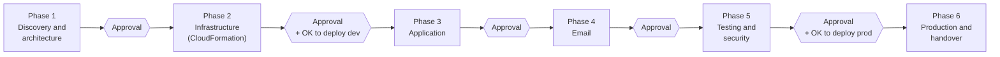

# Phased development and deployment plan

> This follows the brief's six phases. Each phase ends at an **approval gate**: the operator
> reviews a PR and says go before the next phase starts. **No AWS resources are created and
> no costs are incurred without explicit approval.** The table shows the first point at
> which that approval would be asked for.

## Overview

| Phase | Main deliverables | AWS cost incurred? | Exit criteria |
|---|---|---|---|
| **1. Discovery and architecture** (this PR) | The documents in `docs/`, and answers to the open questions | None | The operator approves the architecture and answers the blocking questions |
| **2. Infrastructure** | `bootstrap.yaml`, `edge.yaml`, `main.yaml` and six nested templates. Parameter examples, `deploy.sh` and `destroy.sh`, `deployment.md`, `disaster-recovery.md`, and the infrastructure README. CI running `cfn-lint`. | **None until approved.** `cfn-lint` and `validate-template` are free. Deploying a **dev** stack would cost about US$0.50 a month (or less, with no hosted zone in dev). I will ask before doing it. | Templates pass `cfn-lint` and `validate-template`. The IAM policies are reviewed line by line with the operator. If approved, dev is deployed, a change set is reviewed, and the dev stack is destroyed and redeployed cleanly as a reproducibility test. |
| **3. Application** | The shared package (schemas, pricing), the five Lambdas, the shop UI, the admin UI, Cognito sign-in, product, price and date management, Excel export, a seed script, and the privacy notice | Pennies in dev, if dev is deployed | Unit and integration tests pass locally. The customer and admin journeys work end to end in dev. |
| **4. Email** | The SES identity with DKIM, SPF and DMARC. Customer email templates (acknowledgement, plus status emails if Q9 is approved). The SNS topic and subscriptions. Notifier retries, the DLQ and alarms. The SNS confirmation procedure documented. The SES production access request prepared. | Pennies | Both notification paths are tested in dev: an SES sandbox send to verified addresses, and SNS to the operator's address. Failure paths are tested by injecting an SES error. |
| **5. Testing and security** | Playwright end-to-end tests (iPhone, Android, tablet and desktop viewports). Negative tests: invalid input, duplicates, unauthorised access, throttling. A security review checklist. An accessibility check (axe, keyboard-only, screen-reader spot-check). A PITR restore rehearsal. `TEST-LOG.md` filled in with real results. | Pennies | Every brief §13 test item has a logged result. Anything not tested is listed as not tested. |
| **6. Production and handover** | Deploy prod (with approval). Custom domain and HTTPS. SES production access. SNS confirmations by the baker and her son. A live smoke test with a real test order, then cancelled and erased. The operations guide for the baker, with screenshots. The final README. | About US$0.50–1.00 a month from here, plus the domain | The baker can log in, manage a test order and export it. Both notification emails arrive. The budget alert is active. The operator can recreate the system from the README alone. |

## Testing strategy

| Level | Tool | What it covers |
|---|---|---|
| Unit | Vitest | Price calculations (pence arithmetic, totals), Zod validation, status transitions, order reference generation and the collision retry, email template rendering, Excel workbook contents |
| Integration | Vitest + DynamoDB Local (Docker) | The create-order transaction (idempotency, capacity, rate limit), admin updates with version conflicts, history writes, the notifier's status updates and skip-if-sent |
| Infrastructure | cfn-lint, cfn-guard, `validate-template`, IAM Access Analyzer `validate-policy` | Template correctness and policy hygiene |
| End to end | Playwright against dev | The full customer journey, the admin journey, and mobile viewports |
| Failure injection | Dev-only parameter to force an SES or SNS error | Retries, DLQ, the `notificationProblem` flag, and the alarm email |
| Manual | Real devices (an iPhone and an Android phone at least), Excel desktop | Things automation cannot judge well: emails in real inboxes, Excel formatting, touch usability |

**Honesty rule:** results are recorded in `tests/TEST-LOG.md` with the date, the
environment, the commit and the outcome. Docs and PRs will say "planned" or "not yet tested"
for anything that has not actually been run.

## Expected timing

The calendar is driven mostly by **SES production access** and **domain setup**. AWS's review
of SES production access can take from hours to a few days. To have the system live before
the 2026 Christmas ordering window (the flyer's 2025 deadline was 5 December), a sensible
order is:

1. Register or confirm the domain, and request SES production access **early in Phase 2**.
   Both are manual, one-off and nearly free. The SES request needs the domain, and I will ask
   before doing either.
2. Work through Phases 2–5 in dev.
3. Leave at least a week between prod going live and the first real orders, for a family
   test run.

If the timeline is tight, a fallback is to launch with the acknowledgement email, internal
SNS and Excel export, and add the optional status emails afterwards.
