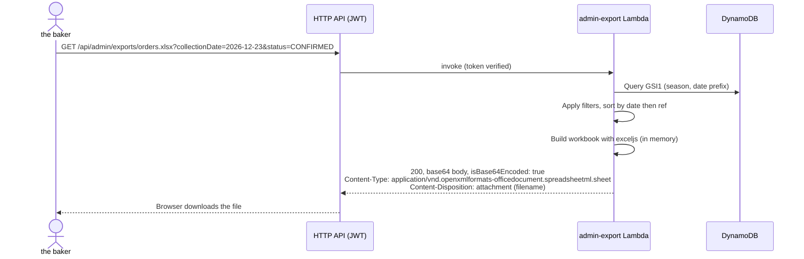

# Excel export

> Phase 1 proposal. Nothing has been built yet.

## 1. What the baker gets

The **Download Excel** button on the orders screen exports **whatever is currently filtered**.
That covers all three cases in the brief with one control:

| Brief requirement | How |
|---|---|
| Export all orders | Clear the filters and download (the active season by default, or "All seasons") |
| Export filtered orders | The current status, payment, search and date filters are sent as query parameters |
| Export a specific collection date | Pick the date in the filter. There is also a shortcut button on each date in "Upcoming collections". |

The file is a genuine Office Open XML workbook (`.xlsx`), not CSV with a renamed extension.
Its name is self-describing, for example `<BusinessName>-orders-2026-12-23-exported-2026-12-20.xlsx`.

## 2. Workbook layout

### Sheet 1: "Orders" (one row per order line)
One order with two different cakes becomes two rows. That keeps **Product, Variant, Quantity
and Unit price** as real columns that the baker can filter, sort and total, which is what the brief's
column list implies. Order-level fields repeat on each row.

| Column | Format | Example |
|---|---|---|
| Order reference | text | KV-7K3QXM |
| Date received | `dd/mm/yyyy hh:mm` (UK time) | 20/11/2026 18:42 |
| Customer name | text | Jane Brown |
| Customer email | text | jane@example.com |
| Customer telephone | text (keeps the leading 0) | 07700 900123 |
| Product | text | 8-inch Jamaican Christmas cake |
| Variant | text | Iced |
| Quantity | whole number | 1 |
| Unit price | `£#,##0.00` | £50.00 |
| Line total *(added)* | `£#,##0.00` | £50.00 |
| Order total | `£#,##0.00` | £80.00 |
| Collection date | `ddd dd/mm/yyyy` | Wed 23/12/2026 |
| Fulfilment status | text | Confirmed |
| Payment status | text | Awaiting payment |
| Internal notes | wrapped text | 21/11 Called to confirm |

I added **Line total** to the brief's list. Without it, "Order total" repeated on every line
would double-count if the baker sums the column. To make that obvious, the order total is shown
only on the **first row of each order**, and its cells on the following rows are left blank.
Both behaviours will be in the Phase 3 tests.

Formatting:
- Bold header row with a deep red fill and white text, matching the branding. The header
  row is frozen, and AutoFilter is on.
- Column widths are sized to the content. Notes wrap.
- Real Excel **dates** and **numbers** are used, not text, so sorting and SUM work.
  Currency uses a £ number format on pence ÷ 100.
- A totals row at the bottom: total quantity and value of the filtered rows.
- Alternate shading by order (not by row), so the lines of one order visibly group
  together.

### Sheet 2: "Baking summary" *(proposed addition)*
This sheet counts each **product and variant per collection date**, for example "23 Dec:
8-inch iced ×6, 6-inch un-iced ×4, Rose mini ×15". This is probably the most useful thing for
planning the baking, and it costs nothing extra to produce. Cancelled orders are excluded.

### Sheet 3: "Export info"
This sheet records when the file was exported, by whom, and the filters that were applied.
That way, a printed copy can always be traced to what it contains.

## 3. How it works

- **Library:** [`exceljs`](https://github.com/exceljs/exceljs). It is MIT-licensed, widely used,
  writes real `.xlsx` files and supports styles, number formats, freeze panes and
  autofilter.
- **Returned directly, not through S3.** A season of 1,000 orders produces a workbook of
  roughly 100–200 KB, well under the 6 MB Lambda response limit and the 10 MB HTTP API
  limit. That means no export bucket, no presigned URLs, and no copies of customer data left
  sitting in S3. If exports ever approach 5 MB, the fallback is to write to a private bucket
  with a 1-day lifecycle rule and return a 5-minute presigned URL.
- **The browser download** uses `fetch` with the bearer token, then a Blob and an object URL.
  The token is never placed in the URL.
- **Read-only IAM:** `admin-export` can only Query and GetItem the table.
- **Memory and time:** 512 MB and a 15-second timeout are plenty. Exports are rare, so the
  cost is negligible.

## 4. Safety

- **Formula injection:** a customer could type `=HYPERLINK(...)` into the notes field.
  Every cell written from customer input is written as an explicit **string** value. Any
  value that begins with `=`, `+`, `-`, `@`, a tab or a carriage return is also prefixed
  with an apostrophe. Excel therefore never evaluates it.
- **The export contains personal data.** Once downloaded, the file is outside AWS's
  protection. The operations guide will advise the baker to keep exports in one place on a
  password-protected device and to delete old ones in line with the retention policy.
- **DynamoDB remains the source of truth.** Edits made in the spreadsheet do not flow back.
  The portal says this next to the button. There is no import feature, by design.

## 5. Testing plan (Phase 3/5)

These are **planned tests**. None have been run, because nothing has been built yet.

- Unit tests open the generated workbook with `exceljs` and assert the sheet names, the
  headers in order, the cell types (date, number, string), the number formats, the totals,
  the first-row-only order total, and the apostrophe-prefixing of formula-like input.
- A filter test checks that each filter combination returns exactly the expected rows.
- A manual check opens the file in Excel for Windows or Mac and in Excel Online. That is
  recorded in the test log with the date and versions.
