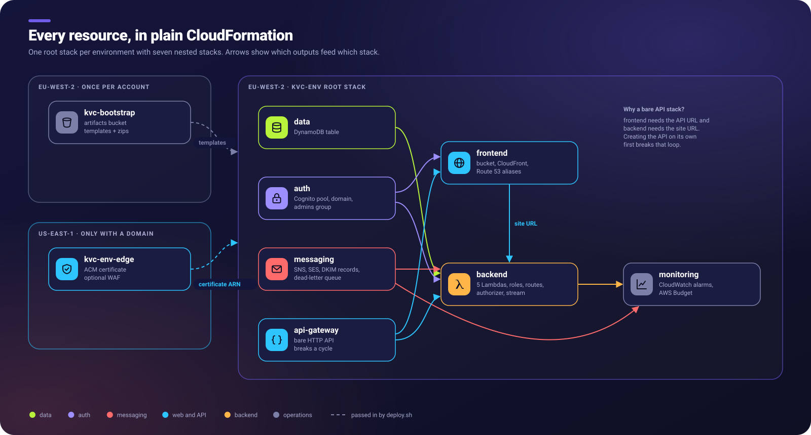

# CloudFormation infrastructure

This folder holds every AWS resource for the shop as plain CloudFormation YAML.
It uses no SAM, CDK or Terraform. For how to run it, see
[docs/deployment.md](../../docs/deployment.md). For why it is shaped this way, see
[docs/cloudformation-design.md](../../docs/cloudformation-design.md).

> **Status (Phase 2):** the templates pass `cfn-lint` 1.59.0 with no errors or warnings.
> **They have not been deployed.** `aws cloudformation validate-template` needs AWS
> credentials and has not been run yet. Run `scripts/validate.sh --aws`.

## Files

| File | Region | Deployed as | Purpose |
|---|---|---|---|
| `bootstrap.yaml` | eu-west-2 | `kvc-bootstrap` (once per account) | Artifacts bucket for packaged templates and Lambda zips. The account's US$5 monthly budget. |
| `edge.yaml` | **us-east-1** | `kvc-<env>-edge` (only with a domain or WAF) | ACM certificate for CloudFront. The optional WAF web ACL. **Not deployed now** (decision D2). |
| `main.yaml` | eu-west-2 | `kvc-<env>` | Root stack: wires the nested stacks together |
| `nested/data.yaml` | eu-west-2 | nested | DynamoDB table (on-demand, PITR, stream, TTL, retained) |
| `nested/auth.yaml` | eu-west-2 | nested | Cognito user pool, `admins` group, admin user, sign-in domain (retained) |
| `nested/messaging.yaml` | eu-west-2 | nested | SNS order topic (up to 5 subscribers), ops alert topic, notifier DLQ. SES identity and DNS records only with a domain. |
| `nested/api-gateway.yaml` | eu-west-2 | nested | The bare HTTP API. It is its own stack to break a dependency cycle (see below). |
| `nested/frontend.yaml` | eu-west-2 | nested | Private site bucket, OAC, CloudFront distribution, SPA routing function, cache and security-header policies, optional Route 53 aliases |
| `nested/backend.yaml` | eu-west-2 | nested | 5 Lambdas with 5 IAM roles and their log groups, Cognito app client and branding, API routes, JWT authorizer, stage and throttling, notifier stream trigger |
| `nested/monitoring.yaml` | eu-west-2 | nested | CloudWatch alarms to the ops topic (9 in prod, 1 in dev, which keeps the account within the 10 free alarms) |
| `github-deploy-role.yaml` | eu-west-2 | `kvc-github-deploy` (once, from the console) | GitHub OIDC provider and a deploy role that only this repository's `dev`/`prod` environments can assume. Used by `.github/workflows/deploy.yml`. |
| `parameters/*.example.json` | — | — | Every parameter, with placeholder values. Copy to `<env>.json`, which git ignores. |
| `.cfnlintrc.yaml` | — | — | cfn-lint configuration |

## Stack dependencies

**Why `api-gateway` is separate (the cycle):**

1. CloudFront (frontend) needs the API's hostname as an origin.
2. The Cognito app client needs CloudFront's URL as its sign-in callback, because there is
   no custom domain yet.
3. The API's JWT authorizer needs the app client ID.

If the API, its routes and the authorizer were in one stack, steps 1 to 3 would form a
loop that CloudFormation rejects. Creating the **bare API** first breaks the loop. The
order becomes: bare API, then CloudFront, then the app client, then the routes and
authorizer (backend).

**Cross-region values:** CloudFormation exports cannot cross regions. `deploy.sh` therefore
reads the us-east-1 edge stack's outputs and passes them in as parameters.

## Parameters

| Parameter | Where set | Notes |
|---|---|---|
| `Environment` | params file | `dev` or `prod` |
| `ProjectName` | params file | `kvc`, the resource name prefix |
| `BusinessDisplayName` | params file | The shop's name. Without spaces it is also the SNS topic prefix and the `Project` tag, so changing it in a live environment replaces the topics. |
| `BakerName` | params file | First name used in the shop and in customer emails |
| `AdminEmail` | params file | Cognito creates this user and emails it a temporary password |
| `SecondAdminEmail` | params file (optional) | Same, for a second admin. Leave empty for none |
| `InternalNotificationEmails` | params file | Comma-separated, **no spaces**, up to 5. Each gets an SNS confirmation email. |
| `OpsAlertEmail` | params file | Alarm and budget emails |
| `CognitoDomainPrefix` | params file | Must be globally unique. It must not contain "aws", "amazon" or "cognito". |
| `LogRetentionDays` | params file | 7 in dev, 30 in prod |
| `CreateOrderReservedConcurrency` | params file | 0 means no reservation (dev). See deployment.md before setting it in prod. |
| `DomainName`, `HostedZoneId` | params file | Empty for now (D2) |
| `EnableWaf` | params file | `false` (accepted recommendation). Read by deploy.sh for the edge stack. |
| `CustomerEmailEnabled`, `SesFromAddress` | params file | Off until there is a domain (D3) |
| `MonthlyBudgetUsd` | params file | Used by the bootstrap stack |
| `ArtifactsBucketName`, `CodeVersion` | deploy.sh | `CodeVersion` is a content hash of the Lambda zips |
| `CertificateArn`, `WebAclArn` | deploy.sh | Taken from the edge stack, when it is deployed |
| `OriginVerifySecret` | deploy.sh | Random, `NoEcho`. Generated on create, kept on updates, and rotated with `--rotate-origin-secret`. |

## IAM review (Phase 2)

Every role was reviewed by hand against what its function needs (docs/data-model.md and
docs/architecture.md §3). The table summarises it:

| Role | Allowed | Deliberately not allowed |
|---|---|---|
| public-catalogue | `GetItem` and `Query` on the `CATALOGUE`, `CONFIG` and `SEASON#*` partitions only (`dynamodb:LeadingKeys`) | Any order data. Any write. The GSI. |
| public-create-order | Read the same partitions plus `IDEMP#*`. `PutItem` on `ORDER#*` and `IDEMP#*`. `UpdateItem` and `ConditionCheckItem` on `SEASON#*` and `RATE#*`. | Reading or updating existing orders. The GSI. Delete. |
| admin-api | Get, Query, Put, Update and ConditionCheck on the table and `gsi1`. `sns:ListSubscriptionsByTopic` on the order topic. | `DeleteItem` (erasure anonymises; expiry is TTL). Publishing to SNS. SES. |
| admin-export | `GetItem` and `Query` on the table and `gsi1` | Any write |
| notifier | Read the table **stream**. `GetItem` and `UpdateItem` on `ORDER#*`. `GetItem` on `CONFIG`. `sns:Publish` on the order topic only. KMS only via SNS and only for `alias/aws/sns`. `sqs:SendMessage` to its DLQ. `ses:SendEmail` only from the configured address, identity and configuration set, and only when customer email is enabled. | Reading the catalogue or the GSI. Publishing to any other topic. Sending from any other address. |
| all | `logs:CreateLogStream` and `logs:PutLogEvents` on **their own** log group | `logs:CreateLogGroup`, because the log groups are pre-created with retention |

Residual points, accepted and documented:

- `TransactWriteItems` is authorised through its component actions (Put, Update,
  ConditionCheck). That is how DynamoDB IAM works, so the LeadingKeys conditions still apply.
- The origin-verify secret is a Lambda environment variable. Anyone with
  `lambda:GetFunctionConfiguration` in the account can read it. It is defence in depth
  against bypassing CloudFront, not an authentication secret. Admin routes still require a
  Cognito JWT.
- The deploying user needs broad permissions (it creates IAM roles). Use an Identity Center
  admin session with MFA, not long-lived access keys.
- `kms:GenerateDataKey` uses `key/*` as the resource, narrowed by the `kms:ViaService` and
  `kms:ResourceAliases` conditions. The ARN of an AWS-managed key cannot be referenced
  before it exists in a new account.

**Not yet done:** IAM Access Analyzer `validate-policy` and `check-no-new-access` need AWS
credentials. They are part of the first dev deployment checklist in docs/deployment.md.

## Things to verify on the first dev deploy

These are design assumptions. cfn-lint can check syntax, but not behaviour:

- [ ] CloudFront forwards the `Authorization` header to `/api/admin/*` through the custom
      cache policy, and the JWT authorizer accepts the Cognito access token (`client_id`
      claim).
- [ ] The SPA routing function serves `/admin/...` deep links, and API 4xx responses stay
      as JSON (no HTML error pages).
- [ ] The managed-login page renders with the default branding (`ManagedLoginVersion: 2`).
- [ ] CloudWatch alarms can publish to the unencrypted ops topic, and SNS delivers to an
      email subscriber.
- [ ] The notifier stream filter delivers INSERTs of `Order` items, and ignores the
      notifier's own updates.
- [ ] Route throttling on `POST /api/orders` (1 rps, burst 5) returns 429 when exceeded.
- [ ] Destroy and redeploy of dev works from a clean state (reproducibility test).
